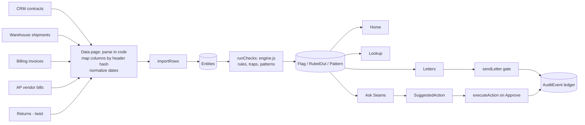
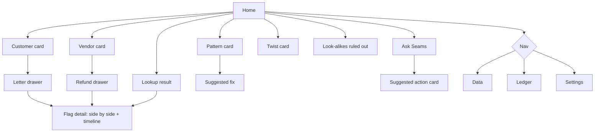
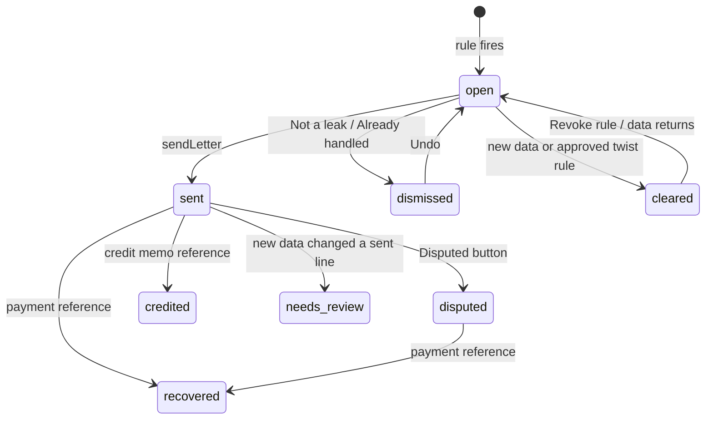
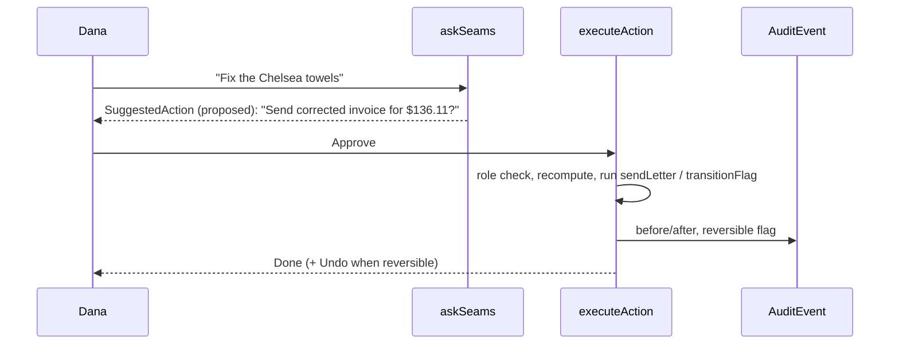

# Seams: Cursor Build Plan (end to end, entire product)

> **This is the one document Cursor follows.** It covers setup, architecture, every feature, every backend function contract, every screen, the milestones with prompts and tests, the demo, and the transfer to Base44. `tools/PLAN.md` is background reading; if they disagree, this file wins.
>
> **How to use it in Cursor:** open the repo, then for each milestone paste the **Prompt** into Cursor's agent, let it implement, run the **Tests**, and check the **Gate** by hand. Do not start the next milestone until the gate passes. Commit after each milestone.

---

## Part 1. Context

### 1.1 The product
Northline Supply (40 staff, 200 NYC restaurant and office customers) runs four disconnected systems: CRM contracts, warehouse shipments, billing invoices and AP vendor bills. **Seams compares the four systems, finds every place they disagree, ranks the disagreements by money, and settles each one both ways**: what customers owe Northline, what Northline owes customers, and what vendors owe Northline. Every finding shows the records from each system side by side, and every fix needs Dana's click.

- **Name and tagline:** Seams · Mind the gap
- **Hook (dataset numbers only):** "This morning Seams found $18,280.94 Northline is owed and didn't know about, and $180.00 Northline owes its own customers and didn't know about either. Every number you'll see opens the records behind it."
- **Close:** "Dashboards tell Dana something's wrong. Seams settles it, fair both ways, with receipts."
- **Judging:** Catch 30% · Product sense 30% · Proof 20% · Action 20%.

### 1.2 Non-negotiable rules
1. **Detection first.** Every rule compares two systems and stores side-by-side evidence, the disagreeing field, and a "how we caught it" sentence.
2. **Code computes every dollar** in integer cents. The AI never produces a number.
3. **The AI never changes data.** It only writes a greeting or closing, suggests column mappings, and turns Ask Seams questions into a fixed query or a *suggested action*. Dana approves; a backend function acts; the Ledger logs it; Undo reverses it where possible.
4. **Ranked by money at stake** everywhere. Buckets (recoverable / overdue / credit_owed) never mix.
5. **Patterns only when the data proves them** (3+ flags, one cause).
6. **Dataset numbers only.** Every number on screen opens its source records. No outside statistics.
7. **Flags are never deleted.** They're upserted by `stable_key`; a sent flag is never cleared, it goes to `needs_review`.
8. **Every backend function checks auth and role first.**

### 1.3 Already built and verified in this starter
| Piece | Location | Status |
|---|---|---|
| Detection engine (8 rules + 3 twist templates, 13 trap checks, patterns, ranking, reconcile) | `src/lib/engine/engine.js` | Matches `reference_checks.py` flag for flag, before and after the twist |
| CSV parser + header hash | `src/lib/csv.js` | Tested |
| Local Base44 SDK stand-in (entities, functions, auth, InvokeLLM stub, SendEmail → Outbox) | `src/lib/local/` | Tested |
| Backend functions `runChecks`, `importRows`, `resetDemo` | `functions/` | Tested end to end, including sent → needs_review and the Analyst 403 |
| 14 entity schemas with RLS (Outbox is local-only) | `base44/entities/` | Base44's documented format |
| Starter Home + Data + SideBySide | `src/pages/`, `src/components/` | Syntax-checked; run it tonight |
| Transfer builder (full + compact 3-paste pack) | `tools/make-transfer.mjs` | Output executed; gives the golden numbers |
| Tests | `tests/` | 9 passing |

---

## Part 2. Setup (15 min)

Prerequisites: Node 20 or newer, Python 3, Git, Cursor.
```bash
unzip seams-starter.zip && cd seams-starter
git init -b main && git add . && git commit -m "Seams starter"
npm install
npm test                 # pass 9, fail 0
npm run dev              # open the localhost URL → Data → Reset demo → Home shows $18,280.94
gh repo create seams --private --source=. --push    # optional but recommended (tomorrow's handoff)
```
Open the folder in Cursor; `.cursor/rules/seams.mdc` loads automatically.

**Daily loop:** branch → prompt Cursor → `npm run check` (tests + Python checker) → check the gate in the browser → commit → merge to main → push.

---

## Part 3. Architecture

### 3.1 Data flow


### 3.2 Screen map


### 3.3 Flag lifecycle


### 3.4 Suggest → approve → log → undo


### 3.5 Folder layout (keep it; the transfer depends on it)
```
src/api/base44Client.js        LOCAL ONLY (Base44 has its own at the same path)
src/lib/local/                 LOCAL ONLY (SDK stand-in, shim)
src/lib/engine/engine.js       engine (pure JS) — all shared logic goes here
src/lib/csv.js  src/lib/useEntity.js  src/lib/format.js (add)
src/components/*.jsx           UI components
src/pages/*.jsx                Home, Data, Ledger, Settings
src/App.jsx  src/main.jsx      LOCAL shell (tabs + role switcher)
functions/*.js                 one backend function per file
base44/entities/*.json         one entity per file
tools/                         data, reference checker, PLAN.md, make-transfer.mjs
tests/*.test.mjs               node --test
```

### 3.6 Coding rules (the transfer to Base44 depends on these)
- **Functions:** use exactly the shape of `functions/runChecks.js`. Imports: only the SDK shim line and `../src/lib/engine/engine.js`. `export default async function (req)` returns `Response.json(...)`. First lines: `auth.me()`, then 401/403 checks. Data only through `base44.asServiceRole.entities.X` with `list`, `filter`, `get`, `create`, `bulkCreate`, `update`, `delete`.
- **AI:** only `base44.integrations.Core.InvokeLLM({prompt, response_json_schema})`, always in try/catch with a deterministic fallback. Locally it always throws.
- **Email:** only `base44.integrations.Core.SendEmail({to, subject, body})`. Locally it writes to Outbox.
- **Frontend:** client only as `import { base44 } from "@/api/base44Client"`. Functions via `base44.functions.invoke(name, payload)` → `.data`. Errors: `e.response.data.error`.
- **Styling:** Tailwind with **literal hex classes** only (`text-[#C22A25]`).
- **Names:** every top-level `const`/`function`/`class` name is unique across all `src` files (the compact pack merges them).
- **No new npm packages.** Hashing uses `crypto.subtle` (works in browsers, Deno and Node).
- **Money:** integer cents; format only with `fmt()` from engine.js.

---

## Part 4. Data model (entities)

| Entity | Fields | Writes |
|---|---|---|
| Contract | contract_id, customer_name, sku, contract_price, start_date, end_date, rebill_freight (Y/N), payment_terms_days, billing_email, import_batch_id, source_row | importRows |
| Shipment | shipment_id, order_no, ship_to, sku, qty, ship_date, ship_type, freight_cost, + lineage | importRows |
| Invoice | invoice_no, order_ref, customer, sku, qty, unit_price, freight_billed, amount, invoice_date, due_date, status, paid_date, + lineage | importRows |
| VendorBill | bill_id, vendor, vendor_invoice_no, bill_date, amount, po_no, po_amount, payment_id, paid_date, + lineage | importRows |
| Return | return_id, order_ref, customer, sku, qty_returned, return_date, credit_memo_no, credit_amount, note, + lineage | importRows |
| Flag | stable_key, rule_id, rule, title, why, seam, bucket, lane, party, amount_cents, confidence, evidence[], diff_field, ids[], status, cleared_by, review_reason, dismiss_reason, reference, is_new | runChecks, transitionFlag |
| RuledOut | rule, reason, ids[] | runChecks |
| Pattern | key, title, detail, amount_cents, keys[], fix | runChecks |
| Letter | party, kind, tone, recipient, subject, frozen_body, frozen_total_cents, flag_keys[], sha256, sent_at, approver_emails[] | sendLetter |
| SuggestedAction | source, action_type, params, label, amount_cents, status (proposed/pending_second/approved/rejected/done/undone), audit_event_id | askSeams, executeAction |
| AuditEvent | actor_email, actor_role, action, entity_type, entity_id, before, after, reason, import_batch_id, created_at, reversible, undone | backend only, append-only |
| Setting | as_of_date, overdue_days, po_abs_cents, po_pct, match_window_days, rule_enabled{}, four_eyes_threshold_cents | admin |
| ColumnMapping | header_hash, target_entity, column_map[], date_format | admin |
| Outbox | to, subject, body, from_name, sent_at | LOCAL ONLY |

When a milestone needs a field that isn't listed, add it to the schema JSON in the same commit.

---

## Part 5. Backend function contracts

Every function: `auth.me()` → 401 if no user; 403 if the role is too low; 400 on bad input; `AuditEvent` on every change. "Admin" = Controller, "user" = Analyst.

| Function | Role | Input | Output | Notes |
|---|---|---|---|---|
| `importRows` ✅ | admin | {entity, rows[], header_hash, file_name} | {imported, batch} | Lineage on every row |
| `runChecks` ✅ | admin | {} | {counts{new,cleared,needs_review,reopened}, totals, needs_review[]} | Upsert by stable_key; sent → needs_review |
| `resetDemo` ✅ | admin | {} | {ok} | Clears data + findings, keeps AuditEvent |
| `saveMapping` | admin | {header_hash, target_entity, column_map[], date_format} | {id} | Upsert by header_hash |
| `suggestMapping` | user | {headers[], sample_rows[]} | {target_entity, column_map[{source_col, maps_to, confidence}], source: "ai"\|"fuzzy"} | InvokeLLM, then fuzzy fallback; never imports |
| `lookupRecord` | user | {id} | {kind: "flagged"\|"ruled_out"\|"not_found", flags[], ruled[]} | Matches flag ids/evidence ids, ruled-out ids, case-insensitive, digits-only for orders |
| `transitionFlag` | user: dismiss, dispute; admin: rest | {flag_id, to_status, reason?, reference?} | {flag, audit_event_id} | Allowed transitions in §3.3; recovered needs `reference` (payment), credited needs `reference` (credit memo); dismiss needs `reason` |
| `undoAction` | admin | {audit_event_id} | {ok} | Only events with reversible=true and undone=false; writes a reversal event. A send can't be undone → 409 "Send a correction instead" |
| `buildLetter` | user | {party, kind: customer\|vendor\|correction, tone, exclude_keys[]} | {to, subject, greeting, closing, sections[{title, lines[{key, text, amount_cents, evidence}]}], receipt[], total_cents, footer, warnings[]} | Code writes lines and numbers; AI writes the greeting and closing only; nothing is stored |
| `sendLetter` | admin | {party, kind, tone, exclude_keys[], subject} | {letter_id, sha256} or {pending_second: action_id} | §6.6 gate |
| `approveSecond` | admin (different user) | {action_id} | {letter_id, sha256} | Four-eyes for totals ≥ threshold |
| `applyRuleSpec` | admin | {mode: dry_run\|approve\|revoke} | dry_run: {cleared[], new_recoverable[], new_credit[], trap_hits[], totals_before, totals_after} | Dry run computes in memory, writes nothing |
| `askSeams` | user | {question, context_party?} | {answer, ids[], suggested_action_id?, refused?} | §6.9 |
| `executeAction` | admin | {action_id} | {result, audit_event_id, undoable} | Only status=proposed; runs through the real functions |
| `rejectAction` | user | {action_id} | {ok} | Logged |
| `recordVisit` | user | {} | {since{new, cleared, sent, recovered}, last_seen_at} | Uses AuditEvents after the user's last visit event |

---

## Part 6. Feature specs (what "done" means)

### 6.1 Home (phone-first; laptop 5/7 grid with left column sticky)
| # | Element | Spec |
|---|---|---|
| H1 | Header | "Seams · Mind the gap", as-of date (from Setting), lookup box, nav |
| H2 | Hero | Owed to Northline (red, 40px mono), chips for overdue (amber) and we-owe (green #17734B), "N customers to square up · M vendors to recover" |
| H3 | Settlement bar | 6px bar by dollars: Open (red) · Sent (red outline) · Recovered (green) · Cleared by data (grey stripes) |
| H4 | Scorecard line | "17 flagged · 13 look-alikes ruled out · 0 overturned · since your last visit: +N new, M cleared, K sent". Overturned = dismissed with "Not a leak". After a twist upload, show its banner text here |
| H5 | Line status board | Rows in order: Contract→Billing, Warehouse→Billing, Billing→Cash (amber, separate), AP→Vendors, Returns→Billing (only when present), Credits owed (green, separate). Status word, bar on one shared scale, $ and count. Tap filters H7/H8 |
| H6 | Needs review | Only when present: unmatched records and "correction owed" lines |
| H7 | Customers to square up | Ranked by net. Card: name, net (red, or green if negative), chips, 3-dot stepper (Found → Letter ready → Sent), literal button "Square up $376.11" / "Send $120.00 credit letter". Expand: lines with SideBySide |
| H8 | Vendors to recover | Ranked by $. Button "Request $6,240.00 refund" |
| H9 | Patterns | Ranked by $. Expand: member flags, "Suggest fix" → SuggestedAction |
| H10 | Ask Seams | Input + 4 suggested questions; answer panel with record chips and a suggested-action card |
| H11 | Look-alikes ruled out | Collapsed `details`, each row with reason and ids (ids open a lookup) |
| H12 | Reward state | No open recoverable/credit flags: "Good service on all lines. $X claimed, $Y returned this week." |

### 6.2 SideBySide and flag detail
One column per system (color swatch, system name, record id), field rows, **disagreeing field highlighted**, then the "how we caught it" sentence, then a mono line: seam · confidence · `import batch · row · rule`. Flag detail adds the timeline (AuditEvents for this flag, newest first) and the status buttons allowed by §3.3.

### 6.3 Data page
1. Choose a file → parse in code → show rows parsed.
2. Mapping card: if a ColumnMapping exists for the header hash, prefill and say "Saved mapping reused". Otherwise prefill by fuzzy header match, then call `suggestMapping`. Each source column gets a dropdown of canonical fields for the chosen entity; required fields are marked.
3. Date format: if any date column has values with both parts ≤ 12, ask "MM/DD or DD/MM?". Normalize to ISO before import.
4. Confirm → `saveMapping` → `importRows` → `runChecks` → show "rows parsed X · imported Y" and runChecks counts.
5. Join health: needs_review list from runChecks (unmatched names, blank refs not unique, no contract).
6. Reset demo (admin): `resetDemo`, import the 4 seed files, `runChecks`.

### 6.4 Ledger page
All AuditEvents newest first, filter by action and entity, Undo on reversible ones (admin), "undone" badge after.

### 6.5 Letters (customer, vendor, correction)
- Sections in fixed order: **Credits we owe you** (credit_owed; if rule 8 is on and the customer has none: "We checked: no credits owed.") → **Billing we missed** (recoverable) → **Overdue balance** (overdue). Each line: text, amount, SideBySide. Remove-line toggle (`exclude_keys`).
- Receipt table: for each line, the source records (system, id, key fields).
- Greeting and closing from InvokeLLM (prompt gets the customer name and tone only; reject output with digits, URLs, "@", or the words bank/account/routing/wire/IBAN/SWIFT; fall back to templates per tone).
- Footer: "Northline will never ask you to change bank details by email."
- To: locked, from Contract.billing_email ("from the contract"). Subject editable.
- Net check line: "Letter total $376.11 = card net $376.11".
- Buttons: literal primary (e.g. "Send $376.11 settlement"), "Not a leak" (reason required), "Already handled". A disabled button shows why next to it.
- Vendor refund letters: one direction, lines from vendor-lane flags; recipient = `ap@<vendor-slug>.example` in the mock data (add a VendorContact entity only if the real case provides vendor emails).
- Correction letters: for needs_review lines; explain the change and the new total.

### 6.6 sendLetter gate (server)
1. Admin only. 2. Rebuild the letter in the function (never trust client text except subject and tone). 3. Recompute the total in cents from currently open flags minus exclusions; reject 409 if it differs from the client's total. 4. Reject 409 if any included flag isn't open (idempotent: a second click finds them sent). 5. Recipient = contract billing email. 6. If total ≥ Setting.four_eyes_threshold_cents (default $5,000.00): create SuggestedAction(status pending_second) and return `{pending_second}`. 7. SendEmail. 8. Freeze: Letter {frozen_body, frozen_total_cents, recipient, flag_keys, sha256 = SHA-256(body + total + recipient)}. 9. Flags → sent via the same transition logic. 10. AuditEvent (reversible=false).

### 6.7 Twist card
Shown when a Return file is imported (or any new file type). Shows: file name, rows parsed vs imported, the 3 proposed rules in plain English (from `tools/data/twist_spec.json`), **dry run** numbers, "0 look-alikes hit" check, buttons **Approve rule** (admin) · Reject · Load reviewed spec (uses the JSON) · later **Revoke**. Approve = set Setting.rule_enabled (return_offset, dup_credit_memo, missing_credit) + runChecks + AuditEvent (reversible=true; undo = revoke).

### 6.8 Patterns
From runChecks (engine `findPatterns`). Card: title, detail, $, expand to member flags. "Suggest fix" creates a SuggestedAction (action_type pattern_fix, params {pattern_key, fix}); executing it only logs the internal note (no data change) and marks the pattern "fix logged".

### 6.9 Ask Seams
1. `askSeams` tries InvokeLLM with a JSON schema: `{type: query|suggest_action|unsupported, query?: by_party|by_rule|by_bucket|top_n|ruled_out|changes|patterns, action?: send_letter|send_correction|request_refund|dismiss|pattern_fix, target?: string, n?: number}`.
2. Fallback keyword router (always used locally): "owe"/"credit" → by_bucket credit_owed; "why"/"not flagged" + a name → ruled_out; "changed"/"after" → changes (last runChecks AuditEvent diff); "biggest"/"top" → top_n 3; "fix"/"send"/"correct" + a name → suggest_action; else unsupported.
3. Resolve the target by fuzzy-matching against party names (several matches → return choices; never guess).
4. Code computes numbers; the answer uses templates (or AI phrasing with slot validation).
5. suggest_action → create SuggestedAction(status proposed, label with the amount from code) → return its id. **Nothing executes without Approve.**
6. Refusal text: "I can only answer from Seams' checked records."

Seed answers (gate):
| Question | Expected |
|---|---|
| Which customers do we owe money to? | Tribeca Grill $120.00 (INV-5074), Chelsea Dental Offices $60.00 (INV-5075); total $180.00 |
| Why wasn't the Bronx Realty rent flagged? | Ruled out: 3 bills of $8,500.00 with different invoice numbers (recurring) |
| Fix the Chelsea towels | Suggested action: "Send corrected invoice for $136.11 to Chelsea Dental Offices?" |
| What changed after the returns file? | 1 cleared ($136.11), +$231.20 owed to us, +$170.00 we owe |
| Forecast next quarter | Refused |

### 6.10 Settings (admin; read-only for Analyst with the reason shown)
As-of date, overdue days, PO tolerance ($ and %), match window, four-eyes threshold, a switch per rule (8 + 3 twist), Reset demo. Every change → AuditEvent (reversible=true).

### 6.11 Roles
The local role switcher simulates Controller/Analyst. Every admin action checks on the server; the UI hides nothing but disables with a reason ("Controller only").

### 6.12 Design system
Paper #F6F3EC · card #FFFFFF with border #E2DDD2 · ink #14171F · muted #5B5F68 · CRM #2F5BD3 · Warehouse #D9731A · Billing #1F8A5B · AP #7A4FC9 (swatches only, never text) · owed to us #C22A25 · overdue #8A5A00 on #FBEFD6 · we owe #17734B on #E6F4EC. Inter for text, JetBrains Mono for every amount and id. Sentence case. One primary button per view. The only motion is a 200ms fade on clear. 44px touch targets, visible focus rings, AA contrast.

---

## Part 7. Milestones (prompt → tests → gate)

Numbers referenced below are in Part 8.

### M0. Run the starter (15 min)
**Prompt:** none. Follow Part 2.
**Gate:** `npm test` 9/9; the browser shows $18,280.94 / $13,977.99 / $180.00 after Reset demo.

### M1. Formatting helpers and Home layout (45 min)
**Prompt:**
> Read CURSOR_BUILD_PLAN.md Parts 1, 3.6 and 6.1/6.12. Refactor src/pages/Home.jsx into components in src/components: Hero (H2), Scorecard (H4), LineStatusBoard (H5), CustomerCard (H7, with stepper and literal button), VendorCard (H8), PatternList (H9), RuledOutList (H11), RewardState (H12). Keep the laptop 5/7 sticky layout and the phone stacking (first Square up button visible at 390px). The LineStatusBoard rows, colors and separate amber/green rows are exactly as in 6.1 H5; tapping a row filters customers/vendors. Use only literal hex Tailwind classes and fmt() from engine.js. Keep top-level names unique across files.

**Tests:** add `tests/home-data.test.mjs`. Using the engine and rankParties, assert the board values in Part 8 (by seam) and the customer order (Lenox Hill first, Tribeca with net −12000).
**Gate:** visual check against 6.1; at 390px the first button is visible without scrolling.

### M2. Data page: mapper, date format, join health (60 min)
**Prompt:**
> Implement Part 6.3 fully. Add functions/saveMapping.js and functions/suggestMapping.js per Part 5 (suggestMapping: InvokeLLM with response_json_schema, fuzzy fallback using normalized header similarity to the canonical fields of the chosen entity). Data.jsx: entity picker, mapping card with dropdowns and required markers, saved-mapping reuse by headerHash, MM/DD vs DD/MM prompt for ambiguous dates, ISO normalization, rows parsed vs imported, runChecks counts, join-health list. Keep Reset demo.

**Tests:** `tests/mapper.test.mjs`. The fuzzy mapping maps every messy header in `tools/data/messy_headers/*.csv` to the right canonical field (use DATASET_README's dictionary as the expected map); date normalization turns 09/15/2026 into 2026-09-15.
**Gate:** Reset → import the 4 messy files through the mapper → Home numbers identical to the clean import. Re-importing the same file reuses the saved mapping.

### M3. Lookup, SideBySide polish, flag detail (45 min)
**Prompt:**
> Implement functions/lookupRecord.js (Part 5) and a header lookup box. Results: Flagged (SideBySide per flag), Ruled out (reason + ids), or "Not found in any of the 4 systems". Polish SideBySide per 6.2 (lineage line: import_batch_id and source_row of each evidence record when available; add those to evidence.fields in engine.js only if it doesn't change any flag amount or key). Add a FlagDetail drawer (SideBySide + timeline placeholder + allowed status buttons).

**Tests:** `tests/lookup.test.mjs`. INV-5076 → ruled_out mentioning "invoice-date price"; SH-3060 → flagged short_billed with diff_field qty; "XYZ-999" → not_found; "so 1060" finds SO-1060.
**Gate:** the same results in the browser; the highlighted field is visible.

### M4. Ledger, lifecycle and Undo (60 min)
**Prompt:**
> Implement functions/transitionFlag.js, undoAction.js and recordVisit.js per Part 5 and the lifecycle in 3.3. Every change writes an AuditEvent with before/after and reversible. Build src/pages/Ledger.jsx (6.4), wire the FlagDetail timeline and status buttons (Disputed, Recovered with payment ref, Credited with credit memo ref, Not a leak with reason, Already handled), the H3 settlement bar, the H4 "since your last visit" via recordVisit, and the H6 Needs review section.

**Tests:** `tests/lifecycle.test.mjs`. open→dismissed then undo → open (2 AuditEvents); sent→recovered without a reference → 400; open→recovered → 400 (not allowed); Analyst undo → 403; "overturned" count = dismissed with reason "Not a leak".
**Gate:** the same in the browser; Ledger shows every step.

### M5. Letters and the send gate (90 min)
**Prompt:**
> Implement functions/buildLetter.js, sendLetter.js and approveSecond.js per Part 5 and 6.5/6.6 (crypto.subtle SHA-256; four-eyes via SuggestedAction pending_second; recipient from Contract.billing_email; idempotent). Add LetterDrawer and RefundDrawer components with sections, per-line SideBySide, remove-line toggles, receipt table, footer, locked To, net check, literal primary button, Not a leak / Already handled. Add correction letters for needs_review lines. All shared logic (sections, totals, receipt rows, template greetings/closings, AI output validator) goes in engine.js.

**Tests:** `tests/letters.test.mjs`:
- Tribeca letter: credit-only, total −12000, sections[0] is credits.
- Chelsea: credits first, total 37611, contains "We checked" = false.
- Lenox Hill: has "We checked: no credits owed." when rule 8 is on.
- AI validator rejects "Call 555-0100" and "update your bank details".
- sendLetter twice for Chelsea → second call 409.
- Total mismatch → 409.
- Hudson Paper refund $6,240.00 → pending_second; approveSecond by the same user → 403; by another admin → sent with sha256.
- Outbox has exactly the expected emails.

**Gate:** the same in the browser; Ledger shows the frozen letter with its hash.

### M6. Twist card (45 min)
**Prompt:**
> Implement functions/applyRuleSpec.js (Part 5, 6.7): dry_run runs runEngine in memory with the three twist templates enabled and diffs against stored flags by stable_key; approve sets Setting.rule_enabled and runs runChecks; revoke turns them off and runs runChecks. Build TwistCard (6.7) that appears after a Return import, with Load reviewed spec reading tools/data/twist_spec.json (copy it to src/lib/twistSpec.js as an exported object).

**Tests:** `tests/twist.test.mjs`. After importing the returns: dry run = cleared [136.11], new_recoverable [231.20], new_credit [170.00], trap_hits []; approve → recoverable 1837603, credit 35000, ruled out 16, patterns 5; revoke → back to 1828094/18000/13. If Chelsea's lines were sent first, approve → that line is needs_review, not cleared.
**Gate:** the same in the browser, with the banner on the scorecard line.

### M7. Ask Seams and suggested actions (75 min)
**Prompt:**
> Implement functions/askSeams.js, executeAction.js and rejectAction.js per Part 5 and 6.9 (InvokeLLM intent with the JSON schema, keyword-router fallback, fuzzy target resolution with choices, template answers, SuggestedAction creation). executeAction routes: send_letter/send_correction → sendLetter; request_refund → sendLetter (vendor); dismiss → transitionFlag; pattern_fix → log only. Build the AskSeams component (input, 4 suggested questions, answer with record chips that open lookup, suggested-action card with Approve/Reject) and the PatternList "Suggest fix" button.

**Tests:** `tests/ask.test.mjs`. The 5 rows of the 6.9 table exactly; after askSeams("Fix the Chelsea towels"), Flag statuses are unchanged until executeAction; executeAction as Analyst → 403.
**Gate:** the same in the browser; the Ledger shows nothing until Approve.

### M8. Settings and roles (40 min)
**Prompt:**
> Build src/pages/Settings.jsx (6.10) and enforce roles (6.11) across all functions and buttons. As Analyst, every admin button is disabled with "Controller only". Settings changes write reversible AuditEvents.

**Tests:** `tests/roles.test.mjs`. As Analyst: runChecks, sendLetter, applyRuleSpec, executeAction, undoAction, saveMapping, resetDemo → 403; buildLetter, lookupRecord, askSeams, transitionFlag(dismiss) → allowed.
**Gate:** switch roles in the UI and check that disabled buttons explain why.

### M9. Polish, accessibility and reconcile (40 min)
**Prompt:**
> Apply 6.12 everywhere: AA contrast, focus rings, 44px targets, 200ms fade on clear, empty/error states for every panel, reduced-motion respect. Add a reconcile assertion on Home: sum of live flags by bucket equals the hero numbers, or show a red "Totals don't reconcile" banner. Add the H12 reward state check.

**Tests:** extend `home-data.test.mjs` with a reconcile check.
**Gate:** Lighthouse accessibility ≥ 90 locally.

### M10. Demo pass, transfer pack, tag (30 min)
```bash
npm run check
npm run transfer         # transfer/ + transfer/compact/ (3-paste pack)
git add . && git commit -m "v0.9-mock" && git tag v0.9-mock && git push --tags
```
Run the demo script (Part 9) from Reset twice. Copy `transfer/` to a USB stick or cloud drive.
**Gate:** the Part 10 checklist is all green, twice.

**Rough total:** 10–11 hours of focused work. If the night is shorter, build in this order and stop cleanly at any milestone boundary: M0 → M1 → M2 → M3 → M5 → M6 → M4 → M7 → M8 → M9. Core proof and action come first; Ask Seams and polish last.

---

## Part 8. Golden numbers

| | Before twist | After twist (rules approved) |
|---|---|---|
| Recoverable | 17 · $18,280.94 | 17 · $18,376.03 |
| Overdue | 5 · $13,977.99 | 5 · $13,977.99 |
| Credits owed | 2 · $180.00 | 3 · $350.00 |
| Ruled out | 13 | 16 |
| Patterns | 4 | 5 |

- **By seam (recoverable, before):** AP→Vendors $11,360.40 · Warehouse→Billing $4,887.54 · CRM→Billing $2,033.00.
- **Customer nets:** Lenox Hill 2,407.90 · Greenpoint 1,360.00 · Hudson Yards 978.03 · Bed-Stuy 970.10 · Astoria 528.40 · Chelsea 376.11 · Flatiron 240.00 · Tribeca −120.00.
- **Vendors:** Hudson Paper 6,240.00 · Atlas 3,368.40 · Empire Glove 950.00 · CleanCo 802.00.
- **Patterns:** glove price after 9/15 $1,440.00 (4 invoices) · Lenox Hill repeat $2,407.90 · freight pass-through $404.11 · duplicate formatting $9,608.40 · (after the twist) Hudson Yards repeat $1,209.23.
- **Twist:** Chelsea short-bill $136.11 cleared (RET-0401) · CM-305/cm305 +$231.20 · Greenpoint RET-0418 +$170.00 owed.
- **Key IDs:** Tribeca credit INV-5074 · Chelsea credit INV-5075 · glove trap INV-5076 · Chelsea short-bill SH-3060/INV-5057 · Hudson Paper duplicate B-9014/B-9015.

---

## Part 9. Demo script (2 minutes, dataset numbers only)
1. **Hook (15s):** the line in 1.1, on the Home screen.
2. **Catch (30s):** the line status board, "62% of it is on the vendor side". Type INV-5076 in the lookup: "Ruled out: invoice-date price applies." Seams doesn't cry wolf.
3. **Proof + action (40s):** Tribeca Grill → "Send $120.00 credit letter": credits first, receipt, locked recipient, footer. Send → stepper moves, Ledger shows the frozen letter and hash.
4. **AI that suggests, never acts (15s):** Ask "Fix the Chelsea towels" → suggested $136.11 correction → "Nothing happens until Dana approves."
5. **Twist (15s):** import the returns → dry run "1 cleared, +$231.20, +$170.00 we owe, 0 look-alikes hit" → Approve.
6. **Close (5s):** the line in 1.1.

---

## Part 10. Final checklist (all green twice, from Reset)
- [ ] Part 8 numbers before and after the twist; reconcile banner absent
- [ ] Every flag: side by side, disagreeing field highlighted, sentence with $
- [ ] Every list ranked by $; 4 patterns → 5 after the twist
- [ ] Lookup: INV-5076 ruled out; SH-3060 flagged; unknown id not found
- [ ] Letters: Tribeca credit-only; Chelsea credits first $376.11; receipt; footer; locked To
- [ ] sendLetter: once only; mismatch blocked; four-eyes on $6,240.00; hash in Ledger
- [ ] Lifecycle: references required; Undo works on reversible events; sent → needs_review on new data
- [ ] Ask Seams: 5 seed answers exact; nothing changes without Approve
- [ ] Analyst: every admin action 403 and disabled with a reason
- [ ] Messy-header import identical; saved mapping reused
- [ ] Phone 390px and laptop layouts; AA contrast
- [ ] No outside statistics anywhere; every number opens records
- [ ] `npm run transfer` succeeds (no duplicate names); `transfer/` copied off the laptop

## Part 11. Tomorrow
Follow `BASE44_TRANSFER.md` (fast route: `transfer/compact/` = 3 pastes). The order is: data tables → functions → golden numbers on mock data → screens → real data → twist. Freeze at 7:10.
