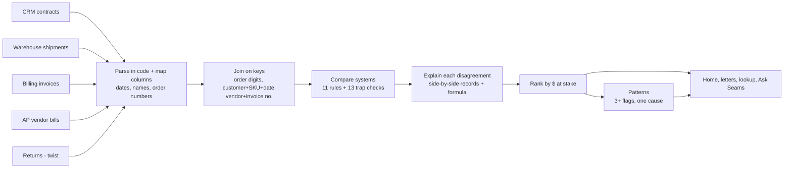
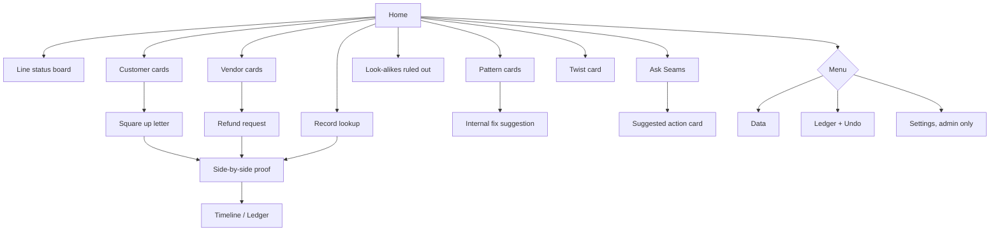
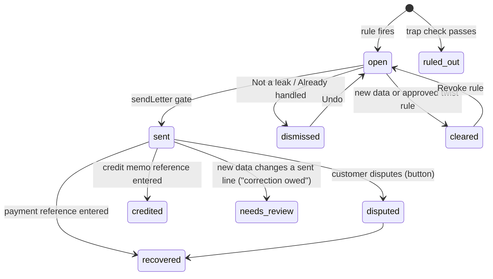
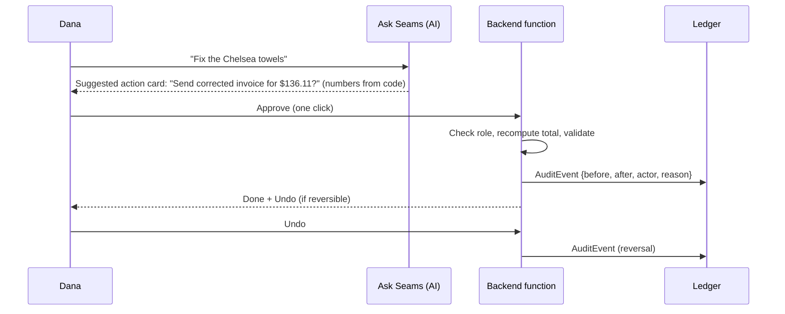
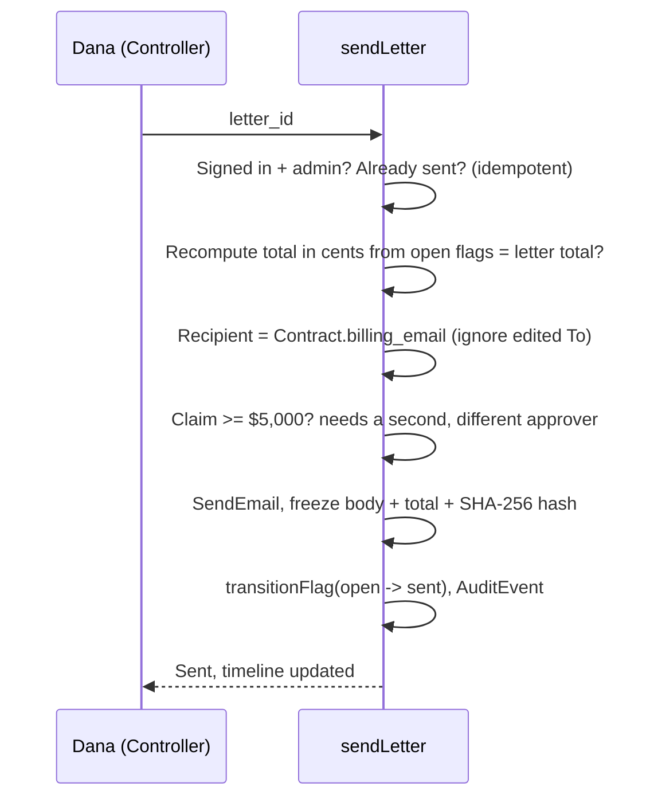

# Seams: Build Plan (Base44 edition, v3 merged)

> **No Base44 credits until the event.** Tonight: follow **CURSOR_BUILD_PLAN.md** in the starter (engine, 3 backend functions, local Base44 stand-in, entities, starter screens and 9 passing tests are already built). Tomorrow: follow **BASE44_TRANSFER.md**. §0.1 and §0.2 below summarize both. The milestones (§11) are the same; only where they run changes. If Base44 GitHub sync turns out to be available on the day, §2 describes that faster path.

## 0.1 Tonight: Cursor only, shaped like Base44

Build a local **React + Vite + Tailwind** app (the same stack Base44 generates) laid out exactly like a Base44 repo, so pieces can be lifted straight across:

```
seams-local/
├── src/pages/            Home.jsx, Data.jsx, Ledger.jsx, Settings.jsx
├── src/components/       (same list as §2)
├── src/lib/engine/       engine in plain JavaScript (ES modules, JSDoc types, no TS-only syntax)
├── src/lib/db.js         tiny adapter with Base44-style calls: Entity.list(), .filter(), .create(),
│                         .update(), backed by localStorage
├── src/lib/fn.js         calls functions/*.js locally the way the Base44 SDK would call backend functions
├── functions/            runChecks.js, importRows.js, resetDemo.js (built) + transitionFlag.js, buildLetter.js, sendLetter.js,
│                         applyRuleSpec.js, lookupRecord.js, askSeams.js, executeAction.js,
│                         undoAction.js, resetDemo.js (each: export default async (params, ctx) => {...})
├── base44/entities/      one JSON schema per entity (§6), Base44's documented default folder
├── tools/                this kit (data, reference_checks.py, PLAN.md, twist_spec.json)
└── tests/                golden tests against tools/data answer keys
```

Rules for tonight:
- **Engine in plain JS**, not TypeScript, so the same file pastes into a Base44 backend function or a Base44 page without edits.
- **The AI is stubbed** with the template fallbacks (§7, §9). Add a real LLM key only if you have one; tomorrow it becomes Base44's InvokeLLM.
- **"Send" writes to an outbox panel** instead of emailing. Tomorrow it becomes Base44 SendEmail inside sendLetter.
- **Roles are simulated** with a role switcher (Controller / Analyst) so the security gates and the demo can be tested.
- Run every milestone gate (§11) locally. M0 changes to: scaffold `seams-local` with Vite + React + Tailwind, the db/fn adapters, and CI.
- Rehearse the full demo on the local app twice. If Base44 has a bad day tomorrow, this app is your backup to show.

## 0.2 Tomorrow: the transfer into Base44 (with event credits)

**At kickoff (5 min):** check what the event credits unlock. Are backend functions available? Is GitHub sync available? Then pick the path:

| Path | When | How |
|---|---|---|
| **B: Paste and prompt (default)** | Backend functions available, no GitHub sync | 1) Create the entities from `entities/*.json` (paste each schema into the entity editor, or prompt "create entity X with these fields"). 2) Create each backend function and paste the matching `functions/*.js` with the engine inlined. 3) Prompt the UI page by page, pasting the component code from `src/components` and `src/pages` and asking Base44 to wire it to the real SDK. 4) Import the real CSVs through the Data page. |
| **C: Frontend-only** | No backend functions on the event plan | Run the engine inside the Home page (it's plain JS). Keep the Ledger, Undo and suggested actions. Shrink the security claim: no server gate, so say "next: server-side send gate". |
| **A: GitHub sync** | Builder plan with sync available | Follow §2: connect, clone, copy `src/`, `functions/`, `entities/` in, merge to main, Publish. Fastest if available, but don't depend on it. |

**Transfer timing (path B):** entities 15 min → functions 25 min → UI 45 min → real-data import and rule tuning 30 min → twist and demo prep in the remaining time. Gate after each step: the golden numbers (on mock data) before switching to the real data.

**Make tonight's transfer pack (last task tonight):**
- `transfer/engine.bundle.js`: the whole engine in one file
- `transfer/functions/*.js`: each function with the engine inlined
- `transfer/entities/*.json`: the schemas
- `transfer/ui-prompts.md`: one prompt per page or component, each with the component code attached
- `transfer/CHECKLIST.md`: the path B steps and gates above


---

## 0. Decisions locked

| Decision | Choice |
|---|---|
| Build target | Tonight: a Base44-shaped React + Vite app in Cursor (§0.1). Tomorrow: Base44 via paste and prompt (§0.2) |
| Repos | **One** repo (`seams-local`) tonight. If Base44 GitHub sync is available tomorrow, its repo becomes the app repo (§2) |
| Canonical dataset | This kit's `data/` (verified by `data/reference_checks.py`). Ignore other reference-app numbers |
| Numbers rule | Every number in the app and demo comes from the dataset and opens its source records. No outside statistics |
| Where effort goes | **Detection first.** Comparing the four systems and explaining each disagreement beats screen polish |
| AI role | Writes greetings and closings, suggests column mappings, and turns Ask Seams questions into a fixed query or a **suggested action**. It never computes a number and never changes data by itself |
| v3 adopted | Ledger (AuditEvent), status lifecycle, sendLetter server gate, roles + RLS, record lookup, line status board, settlement bar, stepper, literal button labels, "look-alikes ruled out" wording, letters built on open and frozen at send |
| Changed from v3 | Undo is back for every reversible action (Ledger-based). Sent letters can't be unsent; they get a logged "Send correction" instead. Patterns are back as rule-computed cards |
| Blockers | Tonight: ask the hosts whether a pre-built app is allowed. Tomorrow at kickoff: check whether event credits include backend functions and GitHub sync, and invite demo email recipients as app users (SendEmail reaches registered users only) |

---

## 1. The idea

Northline Supply (40 staff, 200 NYC restaurant and office customers) keeps its data in four systems that don't talk to each other: CRM contracts, warehouse shipments, billing invoices, AP vendor bills. **Seams compares the four systems, finds every place they disagree, and settles each disagreement both ways**: what customers owe Northline, what Northline owes customers, what vendors owe Northline. Every finding comes with the records side by side, and every fix needs Dana's click.

**Demo hook (dataset numbers only):** "This morning Seams found $18,280.94 Northline is owed and didn't know about, and $180.00 Northline owes its own customers and didn't know about either. Every number you'll see opens the records behind it."
**Close:** "Dashboards tell Dana something's wrong. Seams settles it, fair both ways, with receipts."

### Ground rules
1. Code finds every problem and computes every dollar (integer cents).
2. Every flag explains **how it was caught**: the records from each system side by side, the field that disagrees highlighted, and the formula in one sentence.
3. Everything is ranked by money at stake. A $3,000 problem sits above ten $20 problems.
4. The AI never changes data. It can only **suggest** an action; Dana approves; a backend function does it; the Ledger logs it; Undo reverses it where reversal is possible.
5. Seams catches patterns, not just single mistakes, and only patterns the data proves (3 or more flags sharing a cause).
6. Dataset numbers only. If a number can't be clicked through to a record, it doesn't ship.

---

## 2. Path A only: repo and workflow (Cursor inside a Base44-synced repo)

### One-time setup (app owner, tonight)
1. Create a blank Base44 app called **Seams** (Builder plan or higher).
2. In the editor: **Dashboard → GitHub icon → Connect to GitHub → Connect GitHub → Authorize Base44 Builder → choose account → Create Repository**.
3. Clone it locally:
   ```
   git clone <repo-url> seams && cd seams
   npm install
   npm install -g base44@latest
   base44 login
   base44 link          # repeat on every fresh clone (link file is gitignored)
   ```
4. Copy this kit into the repo: `tools/` (everything in this zip) and `.cursor/rules/seams.mdc`.
5. Open the folder in Cursor. Run `base44 dev` (local backend + frontend together).
6. **Sync test (10 min):** create one test entity via `entities/Test.json` and merge to `main`. Does it appear in Base44? If not, create the entities in the Base44 editor and keep only code in git. The docs disagree here, so test before relying on it.

### Folder layout
```
seams/                         (Base44-connected repo, branch must be named main)
├── src/
│   ├── pages/                 Home.jsx (/), Data.jsx, Ledger.jsx, Settings.jsx
│   ├── components/            Hero, SettlementBar, Scorecard, LineStatusBoard, Lookup,
│   │                          CustomerCard, VendorCard, PatternCard, SideBySide,
│   │                          LetterDrawer, RefundDrawer, ProofReceipt, Timeline,
│   │                          TwistCard, AskSeams, SuggestedAction, RuledOutList
│   ├── lib/engine/            pure TS engine (source of truth): normalize, joins, rules,
│   │                          traps, patterns, ranking, twist, letters, explain
│   ├── api/                   Base44 SDK client (generated)
│   └── ...                    Base44's own folders (hooks, utils, components/ui)
├── entities/                  one JSON schema per entity (if the sync test passes)
├── functions/                 one TS file per backend function (§7)
├── tools/                     data/, reference_checks.py, PLAN.md, twist_spec.json,
│                              bundle-engine.mjs, tests/
└── .cursor/rules/seams.mdc
```
**Shared engine:** `src/lib/engine/` is the single source. `tools/bundle-engine.mjs` inlines it into the backend functions between `// ENGINE START` and `// ENGINE END` markers, and CI fails if they drift. Tonight, check whether functions can import from a relative path; if they can, import directly and drop the bundler.

### Daily routine
1. Branch (`name/topic`) → build in Cursor → test with `base44 dev` and `npm test`.
2. Run `python3 tools/data/reference_checks.py tools/data/clean`. The app must match it exactly.
3. Pull `main` first (Base44 editor edits create commits there), then merge.
4. In Base44, click **Publish** to go live.

### Never
- `base44 dev --remote` (it writes to production data).
- `base44 deploy`, `base44 functions deploy`, `base44 entities push`, `base44 agents push` (they bypass the repo, and the next sync can overwrite them).
- Hand-editing Base44's generated UI files unless needed (two-way sync can break on them).
- Leaving merge conflicts for Base44 (its AI resolver costs credits). Resolve them locally.

### CI (`.github/workflows/ci.yml`)
On every push or PR: `npm test` (engine golden tests), `python3 tools/data/reference_checks.py` diffed against the committed answer keys, a check that `functions/` matches the engine bundle, and a guard that fails if anything under `tools/data/real/` is committed (real data stays local).

---

## 3. Diagrams

### 3.1 Detection pipeline: where the effort goes


### 3.2 Screen map


### 3.3 Flag lifecycle (v3 statuses)

A sent flag is never silently cleared.

### 3.4 Suggest → approve → log → undo (Ask Seams and every action)


### 3.5 sendLetter gate


---

## 4. Detection spec (the hard part)

### 4.1 Normalization and joins
- `digits(s)`: keep only 0–9 (`SO-1043` = `SO1043` = `so 1043` = `1043`).
- `keynorm(s)`: lowercase, strip non-alphanumerics (`HP-7781` = `hp7781`).
- `normName(s)`: lowercase, punctuation to spaces, expand hosp/grp/mfg/constr, drop inc/llc/corp/group. Match on the **full** normalized name. Unresolved names go to Needs review.
- Invoice→Shipment by `digits(order_ref) == digits(order_no)`. An invoice with a blank ref matches only if exactly one standard shipment has the same customer, SKU and qty within 10 days.
- `contract(customer, sku, date)`: the row whose dates cover that date. Gloves are 18.50 until 9/14 and 21.00 from 9/15.
- **Parse every CSV in code** (papaparse). The AI only suggests the header mapping; show file rows vs imported rows. Save mappings keyed by a **hash of the header row**, not the file name. Ask for the date format when it's ambiguous (9/10 vs 10/9).

### 4.2 Rules: each one compares two systems (each dollar belongs to one rule)
| # | Rule | Systems compared | Bucket | Amount | "How we caught it" sentence |
|---|---|---|---|---|---|
| 1 | Shipped, not invoiced | Warehouse vs Billing | recoverable | qty × contract price + freight if rebill | "Warehouse shipped {qty} {sku} on {date} ({shipment}). Billing has no invoice for order {order}. {qty} × ${price} = ${amt} unbilled." |
| 2 | Short-billed | Warehouse vs Billing | recoverable | missing × contract price | "Warehouse shipped {shipped} ({shipment}), invoice {inv} bills {billed}: {missing} × ${price} = ${amt} missing." |
| 3 | Below contract | CRM vs Billing | recoverable | (contract − billed) × qty | "Contract {ct} says ${cp} from {start}; invoice {inv} on {date} charged ${bp}: {qty} × ${diff} = ${amt}." |
| 4 | Freight not rebilled | Warehouse vs Billing (+CRM rebill flag) | recoverable | cost − billed | "Contract says rebill freight. Carrier cost ${cost} ({shipment}), invoice {inv} billed ${fb}: ${amt} not passed on." |
| 5 | Duplicate vendor payment | AP vs AP | recoverable, vendor | each extra row | "Invoice {no1} and {no2} from {vendor} are the same bill written differently, paid {date1} and {date2}: ${amt} paid twice." |
| 6 | Vendor over PO | AP vs PO | recoverable, vendor | bill − PO above max($25, 1%) | "PO {po} approved ${po_amt}; bill {bill} paid ${amt_paid}: ${amt} over." |
| 7 | Overdue receivable | Billing vs calendar | overdue | open amount | "Invoice {inv} was due {due}, open {days} days." |
| 8 | Billed above contract | CRM vs Billing | credit_owed | (billed − contract) × qty | "Contract {ct} says ${cp}; invoice {inv} charged ${bp}: we overcharged {qty} × ${diff} = ${amt}." |
| 9 | Return explains short-bill (twist) | Returns vs Warehouse vs Billing | clears rule 2 | — | "Return {ret}: {n} units came back, so the {n}-unit gap on {inv} is explained." |
| 10 | Duplicate credit memo (twist) | Returns vs Returns | recoverable | each extra credit | "Credit memo {cm1} and {cm2} are the same credit applied twice: ${amt} over-credited." |
| 11 | Credit never issued (twist) | Returns vs Billing | credit_owed | (billed − kept) × price − credits issued | "Customer returned {n} {sku} ({ret}) on paid invoice {inv}; no credit memo issued: we owe ${amt}." |

### 4.3 Look-alikes ruled out (13 before the twist, 16 after)
Sample shipment · replacement shipment · blank-ref invoice matched uniquely · glove at 18.50 before 9/15 · glove at 21.00 on 9/15 for goods shipped 9/14 · order split across two invoices · unbilled freight for a non-rebill customer · invoice only 6 days late · `so 1990` = `SO-1990` · warehouse name variants · monthly rent (different invoice numbers) · weekly freight (different invoice numbers) · bill $2.40 over PO. After the twist, add: returned units explain a short-bill, and 2 returns correctly credited.

### 4.4 Side-by-side proof (every flag, letter line, lookup result)
- Columns, one per system involved, each headed by a system color swatch and name (e.g. Warehouse | Billing).
- Rows: the fields being compared (qty, price, freight, date, ID). The **disagreeing field is highlighted** and the difference is shown in a final column.
- Under the table: the "how we caught it" sentence from §4.2, the match method and confidence (exact = High; digits-only or unique fallback = Medium), and lineage in small mono (`import #2 · row 41 · rule 2 v1`).
- Example (Chelsea Dental, rule 2): Warehouse SH-3060 qty **20** | Billing INV-5057 qty **17** | gap **3** → "Warehouse shipped 20 towel cases (SH-3060), invoice INV-5057 bills 17: 3 × $45.37 = $136.11 missing."

### 4.5 Patterns (rule-computed, at least 3 flags sharing one cause)
Grouping keys: (rule, SKU, date window) · (customer, any recoverable rule) · (rule, contract attribute) · (rule, vendor-number formatting). If the real data has route, driver or delivery-day fields, the same grouping runs on them; never claim a route pattern without a route field.

Patterns in the seed data:
| Pattern | Evidence | $ | Suggested internal fix |
|---|---|---|---|
| Glove price not updated after the 9/15 contract change | 4 invoices, 4 customers | 1,440.00 | "Update GLV-NIT-100 price in billing to 21.00" |
| Lenox Hill Hospital: repeat issues | 3 recoverable issues across 3 rules | 2,407.90 | "Review Lenox Hill billing setup" |
| Freight not passed on to rebill customers | 3 shipments, 3 customers | 404.11 | "Turn on freight pass-through for rebill accounts" |
| Duplicate payments differ only by invoice-number formatting | 2 vendors | 9,608.40 | "Normalize vendor invoice numbers before payment" |

After the twist, add: Hudson Yards Cowork, 3 recoverable issues, $1,209.23. Pattern fixes are internal suggestions (to billing, AP or the warehouse), never customer letters, and go through the same suggest → approve → log flow.

### 4.6 Ranking
- Every list is sorted by money at stake, descending. Customer cards: net (owed to us − we owe). Vendor cards: amount. Patterns: total. Lines inside a letter: amount within each section.
- Ties: older first. Overdue is ranked separately in its own bucket and never mixed into recoverable.

---

## 5. Golden numbers (gate for every milestone)

| | Before twist | After `twist_returns_log.csv` |
|---|---|---|
| Recoverable (owed to Northline) | **17 issues, $18,280.94** | **17 issues, $18,376.03** |
| Overdue to chase | 5, $13,977.99 | 5, $13,977.99 |
| Credits Northline owes customers | 2, $180.00 | **3, $350.00** |
| Look-alikes ruled out | 13 | 16 |
| Patterns | 4 | 5 |

Per rule before the twist: dup payment 2 / 9,608.40 · unbilled 3 / 3,970.22 · below contract 5 / 2,033.00 · over PO 2 / 1,752.00 · short-billed 2 / 513.21 · freight 3 / 404.11 · overdue 5 / 13,977.99 · above contract 2 / 180.00 (Tribeca Grill 120.00 on INV-5074; Chelsea Dental 60.00 on INV-5075).

Twist effect: Chelsea short-bill $136.11 cleared (3 towels returned, RET-0401) · Hudson Yards credit memo CM-305/cm305 applied twice: +$231.20 recoverable · Greenpoint Bistro returned 5 napkin cases (RET-0418) on a paid invoice with no credit memo: +$170.00 we owe.

Line status board (before twist): Contract→Billing $2,033.00 (11.1%) · Warehouse→Billing $4,887.54 (26.7%) · Billing→Cash $13,977.99 (amber, separate) · AP→Vendors $11,360.40 (62.1%) · Credits owed $180.00 (green, separate). After the twist, add a row Returns→Billing: $231.20 recoverable, $170.00 credit.

Customer nets (recoverable − credits): Lenox Hill 2,407.90 · Greenpoint 1,360.00 · Hudson Yards 978.03 · Bed-Stuy Bagel 970.10 · Astoria 528.40 · Chelsea Dental 376.11 · Flatiron 240.00 · Tribeca −120.00. Vendors: Hudson Paper 6,240.00 · Atlas 3,368.40 · Empire Glove 950.00 · CleanCo 802.00.

---

## 6. Base44 entities

| Entity | Key fields | Who can write |
|---|---|---|
| Contract, Shipment, Invoice, VendorBill, Return | canonical fields (see `data/DATASET_README.md`), import_batch_id, source_row | import function only |
| Flag | stable_key, rule, rule_version, title, why, formula, amount_cents, bucket (recoverable/overdue/credit_owed), lane (customer/vendor/internal), party, seam, confidence, evidence (JSON: system, id, fields, diff_field), status (open/sent/disputed/recovered/credited/dismissed/cleared/needs_review/ruled_out), cleared_by, reference, is_new | backend functions only |
| RuledOut | rule, reason, ids (replaced on every run) | runChecks only |
| Pattern | key, title, detail, amount_cents, keys, fix | runChecks only |
| Letter | party, kind (customer/vendor/correction), tone, frozen_body, frozen_total_cents, recipient, sha256, sent_at, approver_ids | sendLetter only (letters are built on open, stored only when sent) |
| SuggestedAction | source (ask/pattern/flag), action_type, params, amount_cents, status (proposed/approved/rejected/done/undone) | backend functions only |
| AuditEvent | actor_email, actor_role, action, entity_type, entity_id, before, after, reason, import_batch_id, created_at | create by backend only; **no one** can update or delete |
| Setting | as_of_date, overdue_days, po_abs, po_pct, match_window_days, rule_enabled, four_eyes_threshold_cents (500000) | admin only |
| ColumnMapping | header_hash, target_entity, column_map, date_format | admin |

RLS: every entity readable by signed-in users; writes only through backend functions; Setting, Contract and ColumnMapping editable by admin only; AuditEvent update/delete blocked with a condition that can never match (Base44 does not enforce a plain `false` on update).

---

## 7. Backend functions (each checks auth and role first)

| Function | Does | Role |
|---|---|---|
| `importCsv` | Parse in code, apply the mapping (by header hash), insert rows with import_batch_id, report file rows vs imported | admin |
| `runChecks` | Engine: rules 1–8 (+ approved twist rules), traps, patterns, ranking. Upsert by stable_key, never delete; open → cleared when gone; **sent → needs_review** ("correction owed") when gone; returns {new, cleared, needs_review} | admin (also runs after import) |
| `transitionFlag` | The only status changer. Allowed: open→dismissed, sent→disputed, sent→recovered (payment ref required), sent→credited (credit memo ref required), disputed→recovered, any→needs_review (runChecks only). Writes an AuditEvent | user for dismiss/dispute; admin for the rest |
| `buildLetter` | Builds a customer/vendor/correction letter on open: code writes every line, number, the side-by-side proof and the proof receipt; InvokeLLM writes the greeting and closing only (no digits, URLs, "@" or bank words). Adds the footer: "Northline will never ask you to change bank details by email." | user |
| `sendLetter` | The gate in §3.5: admin, idempotent, recompute total in cents, recipient from the contract, four-eyes at $5,000+, SendEmail, freeze with SHA-256, flags → sent, AuditEvent | admin (+ second approver) |
| `applyRuleSpec` | Twist: mode = dry_run / approve / revoke for templates offset_clears_flag, duplicate_key, missing_credit. Dry run computed in code; blocks approval if any ruled-out record would be flagged or an unexpected flag cleared | admin |
| `lookupRecord` | ID → Flagged (with side-by-side) / Ruled out (reason) / Not found in any of the 4 systems | user |
| `askSeams` | InvokeLLM → intent only ({query or suggest_action}); code runs the query; answer phrased with code-filled slots; returns record chips and, when relevant, a **SuggestedAction** (never executes it) | user |
| `executeAction` | Runs an approved SuggestedAction through the right function (buildLetter → sendLetter, transitionFlag, pattern fix note), logs it, returns an undo token | admin |
| `undoAction` | Reverses any reversible AuditEvent (dismiss, status change, rule approval, setting change, pattern fix). A sent letter can't be unsent; Undo offers "Send correction" instead | admin |
| `resetDemo` | Restores the seed, re-runs checks, logs it | admin |

---

## 8. Everything on screen

### Home (phone: stacked; laptop: 5/7 grid, left column sticky)
| # | Element | What it shows | Criterion |
|---|---|---|---|
| H1 | Header | "Seams · Mind the gap", as-of date, **record lookup box** ("Look up any invoice, shipment, bill or order"), menu | P, C |
| H2 | Hero | $18,280.94 owed to Northline (red, mono) · chips: $13,977.99 overdue (amber) · $180.00 we owe customers (green, text #17734B) · "8 customers to square up · 4 vendors to recover" | C, P |
| H3 | Settlement bar | 6 px bar: Open / Sent / Recovered / Cleared by data, by dollars | P |
| H4 | Scorecard line | "17 flagged · 13 look-alikes ruled out · 0 overturned · since your last visit: +N new, M cleared, K sent". The twist banner text appears here after an upload | C |
| H5 | Line status board | 4 rows in order-to-cash order + credits row, one shared scale, status word (Leaking / Cash to chase / Good service), tap to filter | Pr |
| H6 | Needs review | Only if present: unmatched records and sent lines whose data changed ("correction owed") | C |
| H7 | Customers to square up | Ranked by net $. Each card: name, net, chips (owed to us / we owe / overdue), 3-dot stepper (Found → Letter ready → Sent), literal button "Square up $376.11" | A, P |
| H8 | Vendors to recover | Ranked by $. Literal button "Request $6,240.00 refund" | A |
| H9 | Patterns | Ranked by $. "Glove price not updated after 9/15 · 4 invoices · $1,440.00", tap for evidence and a suggested internal fix | P |
| H10 | Ask Seams | Question box with suggested questions; answers with record chips and, when useful, a suggested action card | P |
| H11 | Look-alikes ruled out (13) | Collapsed; each with its reason and side-by-side records | C, Pr |
| H12 | Reward state | "Good service on all lines. $X claimed, $Y returned this week." | P |

### Letter and refund drawers (built on open)
- To (locked: "from the contract"), Subject, tone (warm/firm/nudge, which changes the greeting and closing only)
- Sections: **Credits we owe you** → **Billing we missed** → **Overdue balance**. Each line: amount, the side-by-side proof, and a remove-line toggle.
- Proof receipt, BEC footer, net check ("Letter total = card net").
- Literal buttons: "Send $120.00 credit letter" / "Send $376.11 settlement" · Not a leak (reason) · Already handled. A disabled button always shows why next to it.
- After sending: the timeline shows the frozen letter, timestamp and hash, plus status buttons (Disputed / Recovered with payment ref / Credited with credit memo ref).

### Other surfaces
- **Flag detail / lookup result:** side-by-side proof, "how we caught it", confidence, lineage, timeline.
- **Twist card:** file summary, rows parsed vs imported, suggested mapping, three proposed rules in plain English, dry run ("1 cleared $136.11 · 1 new $231.20 owed to us · 1 new $170.00 we owe · 0 look-alikes hit"), Approve rule · Reject · Load reviewed spec · Revoke.
- **Ask Seams suggested action card:** "Send corrected invoice for $136.11 to Chelsea Dental?" [Approve] [Dismiss]. Approving opens the same letter drawer and gate. Nothing happens without the click.
- **Ledger page:** every AuditEvent, filterable, with Undo on reversible ones.
- **Data page:** upload, mapping, rows parsed vs imported, join health, name mapping.
- **Settings (admin only; read-only for Analyst):** as-of date, thresholds, rule switches, four-eyes threshold, Reset demo.

### Criteria coverage
| Criterion | Where judges see it |
|---|---|
| Catch 30% | 11 rules comparing systems, side-by-side "how we caught it", look-alikes ruled out, lookup, patterns, needs review, trap-safe twist dry run |
| Product sense 30% | Ranked by $, customer-first cards with stepper, credits first, since-last-visit, patterns with fixes, Ask Seams suggestions, reward state |
| Proof 20% | Side-by-side records with the disagreeing field highlighted, proof receipt, lineage, frozen letter + hash, every number clickable |
| Action 20% | Literal one-click buttons, sendLetter gate, suggest → approve → log → undo, status lifecycle to recovered/credited |

---

## 9. Ask Seams (read-only, suggests, never acts)

1. `askSeams` sends the question to InvokeLLM and accepts only JSON: `{type: "query" | "suggest_action" | "unsupported", query?: by_party|by_rule|by_bucket|top_n|ruled_out|changes|patterns, action?: send_letter|send_correction|request_refund|dismiss|pattern_fix, target?}`.
2. Code resolves the target (fuzzy customer names become a choice list, never a guess), runs the query, and computes every number.
3. The answer is phrased with code-filled `{{slots}}`; any digit outside a slot means the template is used instead.
4. For `suggest_action`, code builds a **SuggestedAction** with the amount computed from flags and shows the card. Only Dana's Approve calls `executeAction`. Every step is in the Ledger; Undo applies where reversible.
5. Suggested questions (seed data):
   - "Which customers do we owe money to?" → Tribeca Grill $120.00 (INV-5074), Chelsea Dental $60.00 (INV-5075)
   - "Why wasn't the Bronx Realty rent flagged?" → ruled out: 3 bills of $8,500.00 with different invoice numbers (recurring)
   - "Fix the Chelsea towels" → suggested action: "Send corrected invoice for $136.11?"
   - "What changed after the returns file?" → 1 cleared $136.11, 1 new $231.20, 1 new $170.00 credit
6. Out of scope → "I can only answer from Seams' checked records."

---

## 10. Security (claim only what's enforced)
- Two roles: **Controller** (admin) and **Analyst** (user), checked inside every backend function, because service-role functions skip RLS.
- RLS on all entities (§6); AuditEvent is append-only.
- The sendLetter gate (§3.5), four-eyes at $5,000+ (the $6,240.00 duplicate refund qualifies), and the recipient always from the contract.
- AI never sees amounts or account numbers; output with digits, URLs, "@" or bank words is rejected; BEC footer on every letter.
- App published as **Private** (sign-in required); run Base44's Security Scan clean.
- Honest claim: "Private app with two roles and record-level rules. Every number is computed in code; every letter goes through one server check that recomputes the total, sends once, freezes the letter and logs it. SSO and MFA are next." Never say "compliant" or "tamper-proof".

---

## 11. Milestones (Cursor prompts and gates)

**M0. Repo, setup and sync test**
> Following PLAN.md §2: confirm `base44 dev` runs, copy the kit into `tools/`, add `.cursor/rules/seams.mdc`, add the CI workflow and `tools/bundle-engine.mjs`. Create entities/Test.json, merge to main, and record whether entities sync from git or must be created in the editor.

Gate: the app loads locally and in Base44, CI is green, and the entity sync behavior is known.

**M1. Entities, import and mapping**
> Create the entities in §6 (via git or the editor, per M0) with the RLS in §6. Build `importCsv` and the Data page: parse in code, mapping keyed by header hash, date-format confirmation, rows parsed vs imported, join health.

Gate: importing `tools/data/clean` loads 88 contracts, 87 shipments, 83 invoices and 20 bills; importing `messy_headers` maps to identical rows.

**M2. Detection engine (the most important milestone)**
> Implement `src/lib/engine` per §4.1–4.3 and §4.6 in integer cents, bundle it into `runChecks`, and write tests asserting every number in §5 (per rule, customer nets, 13 ruled out). Each flag stores the side-by-side evidence with diff_field and the "how we caught it" sentence. reference_checks.py is the source of truth.

Gate: all §5 "before twist" numbers match exactly, and every flag's sentence names both systems and the difference.

**M3. Patterns and ranking**
> Implement §4.5 patterns (3+ flags, one cause; route/driver patterns only if those fields exist) and §4.6 ranking everywhere.

Gate: the 4 seed patterns appear with the exact $ amounts; every list is sorted by $.

**M4. Home, side-by-side proof and lookup**
> Build H1–H9 and H11–H12 (§8), the SideBySide component (§4.4), flag detail, and `lookupRecord`.

Gate: golden numbers on screen; the line status board matches §5; looking up INV-5076 (glove at 21.00 on 9/15) says "Ruled out: invoice-date price applies"; looking up SH-3060 shows Warehouse 20 vs Billing 17, gap highlighted; phone at 390 px shows the first Square up button without scrolling.

**M5. Ledger, lifecycle and Undo**
> Build AuditEvent, `transitionFlag` (§7 transitions), `undoAction`, the timeline drawer, the Ledger page, the since-last-visit line, and the settlement bar.

Gate: a dismiss and its undo both appear in the Ledger; Recovered without a reference is refused.

**M6. Letters and the send gate**
> Build `buildLetter` (code-written lines, side-by-side, proof receipt, AI greeting/closing only, BEC footer) and `sendLetter` (§3.5). Add the drawers, literal buttons, stepper, frozen letter view, and four-eyes.

Gate: Tribeca's letter is credit-only, $120.00; Chelsea's nets $376.11 with credits first; a total mismatch blocks sending; a double click sends once; an edited To is ignored; the email arrives at a registered user; the $6,240.00 refund needs a second approver.

**M7. Twist**
> Build the twist card and `applyRuleSpec` with the three templates in `tools/data/twist_spec.json` (dry run → approve → revoke) and "Load reviewed spec". A sent flag affected by new data goes to needs_review, never cleared.

Gate: uploading twist_returns_log.csv gives exactly 1 cleared ($136.11), +$231.20 recoverable, +$170.00 we owe, 0 look-alikes hit; totals become $18,376.03 / $350.00 / 16 ruled out / 5 patterns; Revoke restores.

**M8. Ask Seams with suggested actions**
> Build `askSeams`, `executeAction` and the AskSeams + SuggestedAction components per §9. The AI returns intent JSON only; code computes all numbers; actions run only on Approve and are logged with Undo.

Gate: the four suggested questions give exactly the §9 answers; "Forecast next quarter" is refused; no data changes without a click (verified in the Ledger).

**M9. Roles, security and polish**
> Add the two roles, admin-only Settings/Reset/send, Private publish, Security Scan, AA contrast (credit text #17734B; system colors as swatches only), a 200 ms fade on clear, 44 px targets, empty/error states, and the reconcile check (sum of flags = hero).

Gate: the scan is clean; the Analyst account can't edit Settings or send; the §12 checklist is green.

**M10. Demo pass**
> Run the demo path from Reset twice; tag `v0.9-mock`.

Gate: the §12 checklist is green twice in a row.

---

## 12. Pre-demo checklist
- [ ] Golden numbers before and after the twist (§5); reconcile check green
- [ ] Every flag shows both systems side by side with the disagreeing field highlighted
- [ ] Every list sorted by $; 4 patterns before the twist, 5 after
- [ ] Lookup: INV-5076 ruled out with its reason; a made-up ID says "Not found in any of the 4 systems"
- [ ] Tribeca credit-only $120.00; Chelsea $376.11 credits first; proof receipt matches records
- [ ] sendLetter: mismatch blocked, sends once, recipient from the contract, frozen + hash in the timeline
- [ ] Four-eyes on the $6,240.00 refund
- [ ] Twist: 1 cleared, +$231.20, +$170.00, 0 hits; Revoke works; sent lines go to needs_review
- [ ] Ask Seams answers the four questions exactly, suggests actions, never acts without a click
- [ ] Undo works on dismiss, status change and rule approval; a sent letter offers "Send correction"
- [ ] Analyst can't change Settings or send; app is Private; scan clean
- [ ] Every number on screen opens its source records; no outside statistics anywhere
- [ ] Phone 390 px and laptop layouts clean

## 13. Left out on purpose
| Not building | Why |
|---|---|
| Full SVG transit map | The line status board tells the same story with less risk |
| Charts and trend graphs | Dana acts on accounts; the board and patterns carry the "where" story |
| Free-form chat over raw data, or an AI that acts on its own | It would invent numbers or change billing; Ask Seams suggests, Dana approves |
| Route or driver patterns on the mock data | No route field exists; the engine supports them if the real data has one |
| SSO, MFA, live integrations | Not enforceable on this plan; say "next" in the pitch |

## 14. Tomorrow: swap in the real data
Reset → import each real CSV through the mapper (by header hash) → set the as-of date and thresholds → switch off rules the case can't support → analyst runs `reference_checks.py` (renamed columns) and Prompt 0 in Claude → diff → fix → update the demo numbers and the Ask Seams suggested questions → handle the twist with the twist card → Publish.
